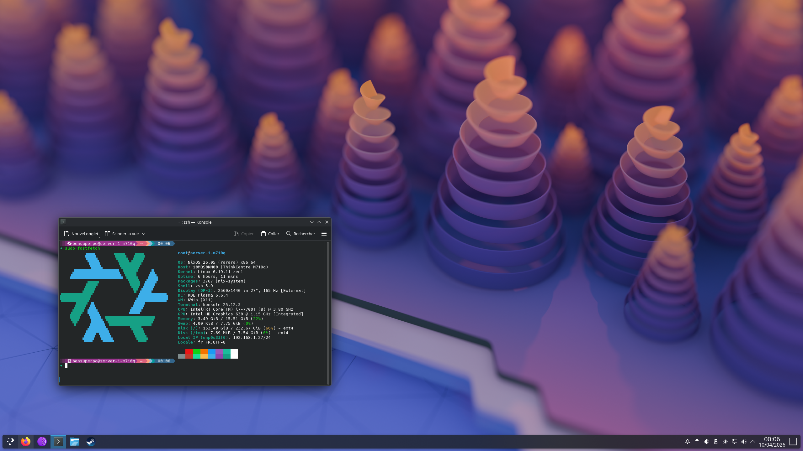

# NixOS Configuration

[](https://github.com/bensuperpc/nixos_config/actions/workflows/ci.yml)

This repository contains my personal NixOS flake used to manage my desktops, servers, and a few family machines.

> **⚠️ Warning:** This repository is under active development, expect changes and occasional breakage.

## Highlights

- Multi-host setup for personal, family, server, and workstation systems
- Flake-based configuration deployed with Colmena (checked to build exactly `nixosConfigurations`)
- Home Manager and KDE Plasma 6 desktop environment
- Declarative disk partitioning with **disko** and impermanence
- Role-based composition (`minimal`, `server`, `desktop`, `workstation`, `full`, `family`)
- Profile-driven capabilities via a single `profiles` list (`platform/*`, `apps/*`, `policy/*`)
- Shared user configuration across hosts via `users/<name>/`
- Deterministic package versions + individual packages pinned to the stable channel via `pkgsSets`
- Per-host nixpkgs channel (`unstable` by default, `stable-2605`)
- Devshells for C/C++ (GCC, Clang), WebAssembly, embedded compilers, Qt6, raylib, Python 3.13 and 2, Rust, Java 21
- Makefile helpers for common maintenance, validation, and deployment tasks
- `microvm.nix` host support (WIP) for running lightweight VMs



## Repository Layout

```bash
.
├── .github/workflows    # CI: gitleaks + `nix flake check`, scheduled flake.lock update PRs
├── .sops.yaml           # sops-nix recipients and one creation rule per host file
├── assets               # Images and media
├── devshells            # Development shells
├── flake
│   ├── checks.nix       # Flake checks (= CI)
│   ├── dev.nix          # Formatter, packages and devshells
│   └── hosts.nix        # Package sets, hosts, Colmena hive
├── flake.lock           # Flake lock file
├── flake.nix            # Flake inputs
├── lib
│   ├── disko-presets.nix   # Shared GPT + ESP + LUKS + btrfs layout
│   ├── host-schema.nix  # Host options (typed), validation and role wiring
│   ├── mksystem.nix     # Per-host NixOS configuration builder
│   ├── module-helpers.nix  # Shared helpers (mkEnabledOption, mkPackageGroupModule, mkDefaults)
│   └── role-presets.nix    # Default profile sets for each role
├── Makefile
├── modules
│   ├── common      # Boot, network, audio, filesystem, SSH, …
│   ├── drivers     # CPU (Intel/AMD), GPU (Intel/AMD/software), Bluetooth
│   ├── gui         # Desktop environment options (gui.nix) and implementations (kde-plasma.nix, …)
│   └── applications # User-facing software
│       ├── ai           # AI tools
│       ├── development  # IDEs, compilers, languages, tools
│       ├── multimedia   # Video, audio, image
│       ├── games        # Steam, emulators, Minecraft
│       ├── desktop      # Desktop integration, fonts, printing
│       ├── microvm      # Lightweight VMs (QEMU, Docker, OCI containers)
│       ├── network      # Browsers, communication, torrent
│       ├── files        # Backup, sync, crypto
│       ├── utilities    # Misc tools, KVM, math, antivirus
│       └── docker       # Docker and Compose services
├── pkgs                # Custom packages (flake `packages` output)
├── profiles            # Composable presets for platform, apps and policy
├── systems             # Per-host definition, configuration, hardware, disko and sops files
├── tests               # Sample projects for the devshells (invariants live in modules as assertions)
└── users               # Per-user system and Home Manager configuration
```

## Host Inventory

Every `systems/<host>/definition.nix` is a host (listed in `systems/systems.nix`, checked against the options of `lib/host-schema.nix`).

- `enabled = true` (default): host is included in global eval/build outputs.
- `enabled = false`: host stays in inventory but is excluded from global eval/build outputs.

Hosts without an IP address are excluded from remote deployment targets.

Every host needs an `ageRecipient` in its `definition.nix` ([sops-nix enrollment](doc/installation.md#enroll-the-host-in-sops-nix)): a host without one fails evaluation, so keep `enabled = false` until its host key exists.

| Host             | Role    | Status                            |
| ---------------- | ------- | --------------------------------- |
| `server-1-m710q` | full    | in preparation (enrolled in sops) |
| `rainbow-dash`   | full    | not installed (disabled)          |
| `fluttershy`     | server  | not installed (disabled)          |
| `celestia`       | family  | WIP (disabled)                    |
| `luna`           | family  | WIP (disabled)                    |
| `pinkie-pie`     | desktop | WIP (disabled)                    |

## Prerequisites

- Linux machine with Nix installed
- Flakes enabled (`nix-command` + `flakes`)
- Optional dependency for remote deployment: `colmena` (provided by `nix develop`, with `sops`, `ssh-to-age` and the linters)
- LiveUSB with NixOS installer for new machine installations
- An admin age key to manage the sops secrets

If you don't have an admin age key yet, generate one **outside the repository**, in the default sops location:

```bash
nix shell nixpkgs#age
mkdir -p ~/.config/sops/age
age-keygen -o ~/.config/sops/age/keys.txt
```

## Quick Start

### Validate the flake

```bash
nix flake show
nix flake check -L
```

Evaluate a host build locally (dry-run):

```bash
nix build --extra-experimental-features "nix-command flakes" .#nixosConfigurations.server-1-m710q.config.system.build.toplevel --dry-run --show-trace --verbose
```

## Deployment

### Apply a host configuration locally

```bash
sudo nixos-rebuild switch --flake .#server-1-m710q
```

### Colmena

```bash
colmena apply --on server-1-m710q --show-trace --verbose
```

To deploy a host from itself instead (no SSH), from a temporary clone of the repository on it:

```bash
nix run --inputs-from . nixpkgs#colmena -- apply-local --sudo
```

## Installation

Go to [installation.md](doc/installation.md) for instructions on installing a new host.

## Rebuilding a host

To rebuild a host from itself, use the GitHub mirror (public, no auth), which only has what was pushed to it:

```bash
nh os switch                     # NH_FLAKE = github:bensuperpc/nixos_config, host = hostname
nrs                              # alias: nixos-rebuild switch --sudo --flake github:bensuperpc/nixos_config#<host>
nixos-rebuild switch --sudo --flake github:bensuperpc/nixos_config/dev#$(hostname)   # another branch
```

## Make Targets

Common targets (they run the host's `nix`):

```bash
make update        # flake update
make check         # flake check
make fmt           # format Nix files
make gc            # garbage collect the store, deleting generations older than 7 days
make all-systems   # show all system outputs
make build-all     # build every host's top-level with nix-fast-build (skips cached ones)
```

Per-host targets, for every host of `nixosConfigurations` (`SERVERS` is read from the flake, override it with `make SERVERS="..."`):

```bash
make <host>.test   # dry-run build
make <host>.build  # build top-level system closure
make <host>.vm     # build VM
make <host>.sbom   # build, then write an SBOM (sbom-<host>.{csv,cdx.json,spdx.json}) with sbomnix
make <host>.push   # deploy with Colmena (switch), hosts with an `ip` only
make <host>.boot   # deploy with Colmena (boot, then reboot), hosts with an `ip` only
```

## Host Roles

Roles are defined in `lib/role-presets.nix` and provide a default list of profiles. Hosts extend it with `profiles` in their `definition.nix`.

| Role          | Platform profiles                                                           | App profiles                                                                                                                                                                                                                                                                         | Policy / extra profiles |
| ------------- | --------------------------------------------------------------------------- | ------------------------------------------------------------------------------------------------------------------------------------------------------------------------------------------------------------------------------------------------------------------------------------ | ----------------------- |
| `minimal`     | _(none)_                                                                    | _(none)_                                                                                                                                                                                                                                                                             | _(none)_                |
| `server`      | `platform/no-gui`                                                           | `apps/docker`                                                                                                                                                                                                                                                                        | _(none)_                |
| `desktop`     | `platform/kde-plasma`                                                       | `apps/desktop-runtime`, `apps/desktop`, `apps/multimedia`, `apps/utilities`, `apps/office`                                                                                                                                                                                           | `policy/kernel-latest`  |
| `workstation` | `platform/kde-plasma`                                                       | `desktop` + `apps/dev-all`, `apps/virtualization`, `apps/network-servers`                                                                                                                                                                                                            | `policy/kernel-latest`  |
| `full`        | `platform/kde-plasma`                                                       | `workstation` + `apps/browser`, `apps/communication`, `apps/torrent`, `apps/files`, `apps/docker`, `apps/games`, `apps/ai`                                                                                                                                                           | `policy/kernel-latest`  |
| `family`      | `platform/kde-plasma`                                                       | `desktop` + `apps/browser`, `apps/communication`, `apps/torrent`, `apps/files`                                                                                                                                                                                                       | `policy/kernel-latest`  |

With impermanence, each module adds the directories it needs to `myConfig.system.impermanence.persistDirectories`
when it is enabled; add host-specific ones to the same option.

## Profile Reference

Go to [profile-reference.md](doc/profile-reference.md)

## Development Shells

Go to [devshell.md](doc/devshell.md)

## Useful Resources

### Nix & NixOS

- [NixOS](https://nixos.org/)
- [NixOS Wiki](https://wiki.nixos.org/)
- [NixOS Search (Packages)](https://search.nixos.org/packages)
- [NixOS Search (Options)](https://search.nixos.org/options)
- [MyNixOS](https://mynixos.com/)
- [Awesome Nix](https://github.com/nix-community/awesome-nix)
- [Nix Gaming](https://github.com/fufexan/nix-gaming/)

### Other NixOS Configurations

- [CageKiosk](https://github.com/stefansebekow/CageKiosk)
- [Midna](https://git.midna.dev/mjm/nix-config)
- [Natto1784](https://github.com/natto1784/dotfiles)
- [Fufexan](https://github.com/fufexan/dotfiles)
- [Tejing1](https://github.com/tejing1/nixos-config)
- [Ryan4yin](https://github.com/ryan4yin/nix-config)
- [Phip1611](https://github.com/phip1611/nixos-configs)
- [Nixicle](https://gitlab.com/hmajid2301/nixicle.git)
- [Haseeb Majid](https://haseebmajid.dev/posts/2024-07-30-how-i-setup-btrfs-and-luks-on-nixos-using-disko/)
